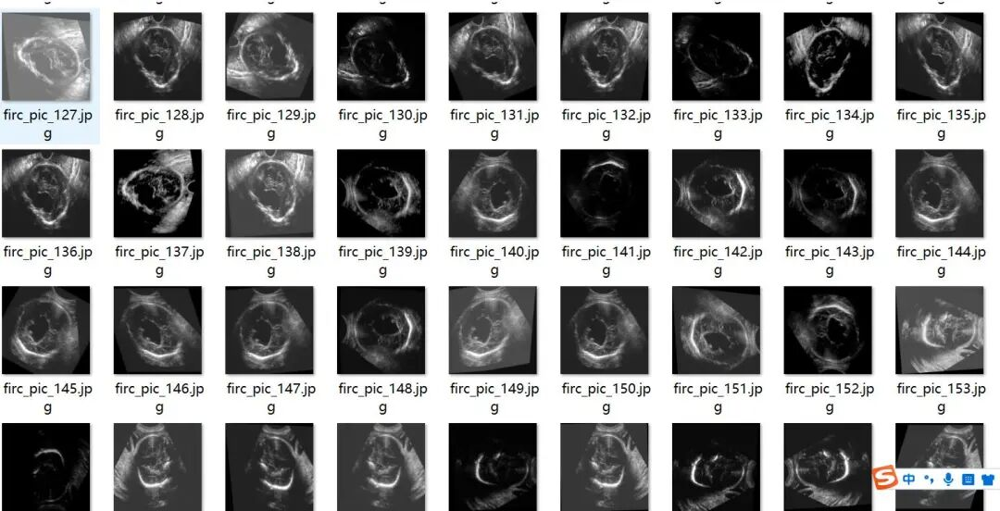
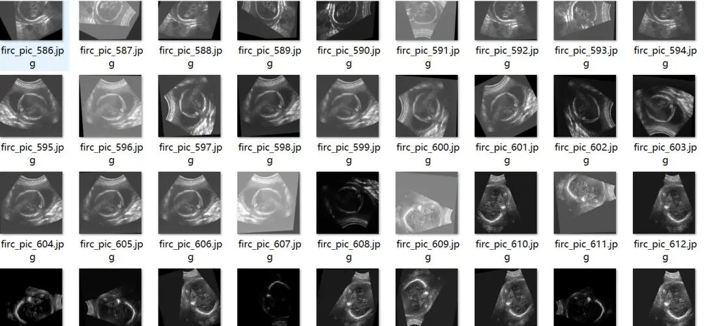
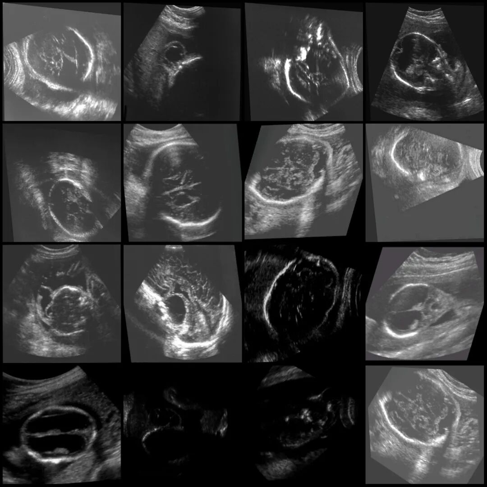
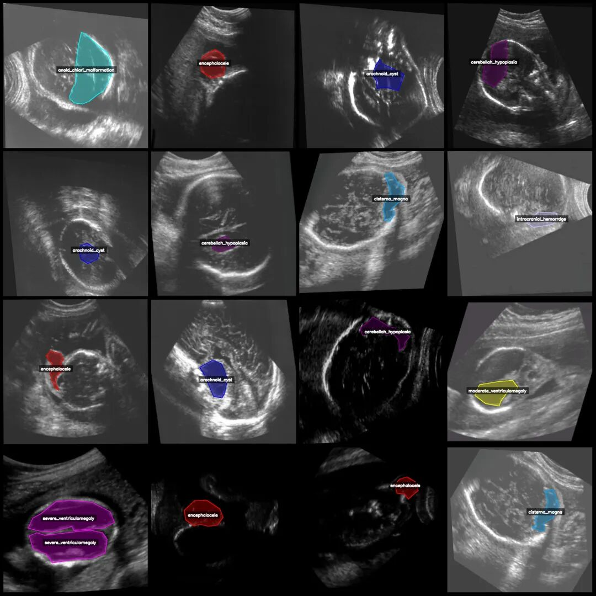
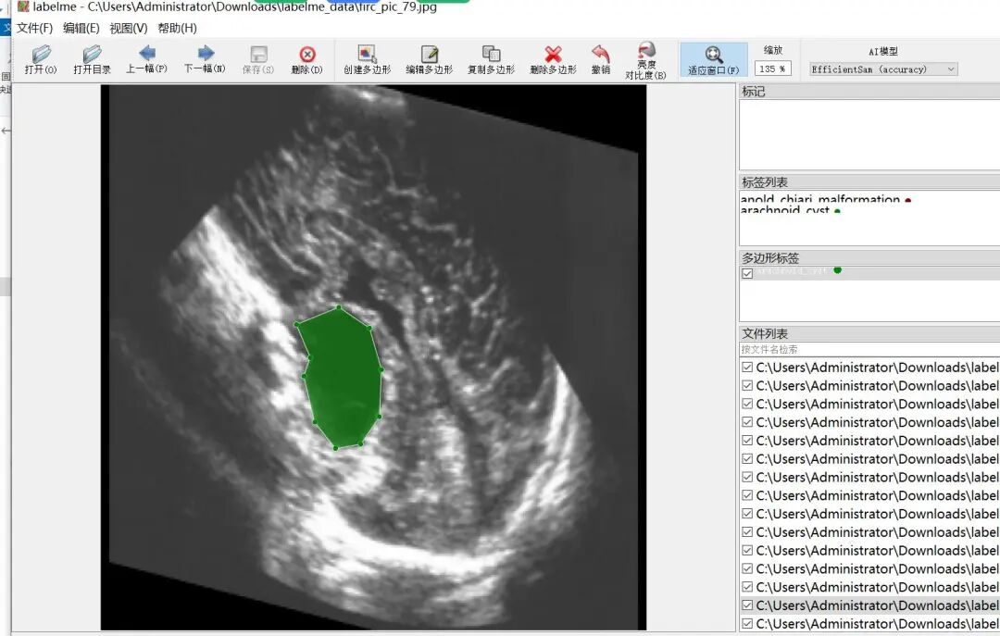

# Intelligent Medical Brain Abnormality Computer-Assisted Segmentation Dataset - LabelMe Format: 1391 images, 14 categories with enhancements

Please note that there is a significant amount of enhancement in the dataset, approximately 1:9 enhancement, meaning the original image is less than 200. For specifics, please refer to the images below.

Dataset format: labelme format (without mask files, only including jpg images and corresponding json files)

Number of images (number of jpg files): 1391

Number of annotations (number of json files): 1391

Label category count: 14

Label category names: ["anold_chiari_malformation", "arachnoid_cyst", "cerebellah_hypoplasia", "cisterna_magna", "colphocephaly", "encephalocele", "holoprosencephaly", "hydracenphaly", "intracranial_hemorrhage", "intracranial_tumor", "mild_ventriculomegaly", "moderate_ventriculomegaly", "polencephaly", "severe_ventriculomegaly"]

Number of boxes labeled in each category:

An old Chiari malformation (Arnold-Chiari deformity) count = 46

Arachnoid Cyst (Spinal Arachnoid Cyst) Count = 122

cerebellah_hypoplasia (cerebellar hypoplasia) count = 114

cisterna magna (sella turcica) count = 40

Colpocephaly (periventricular leukomalacia/lateral ventricle enlargement) count = 92

encephalocele (brain cyst) count = 162

Hydrocephalus (hydrocephaly) count = 12

Hydrocephaly (water-filled brain malformation) count = 26

Intracranial hemorrhage (intracranial hemorrhage) count = 64

Intracranial_tumor count = 14

Mild ventricular enlargement (mild ventriculomegaly) count = 285

Moderate ventricular enlargement (moderate ventriculomegaly) count = 272

Polencephaly (multiple cerebellar hemispheric dysplasia) count = 104

Severe ventricular dilation (severe ventriculomegaly) count = 137

Total frame count: 1490

Using labeling tool: labelme=5.5.0

Image resolution: 640x640

Annotation rules: Draw polygons around the categories.

Important Notice: The dataset can be opened and edited using LabelMe. For JSON datasets, one must convert them into mask or Yolo formats for semantic segmentation or instance segmentation.

Special : This dataset does not guarantee the accuracy of the trained models or weight files.

Image Preview:

Annotation example:

Original image (pick 16 randomly):

Annotation:

LabelMe editing example:

## Payment

Here is a pay link on Stripe ( https://buy.stripe.com/3cs8yP7sY87d0vu9AB ). Please contact me lonlonago@foxmail.com after funding $89, and I will send you a complete data files , thank you!

